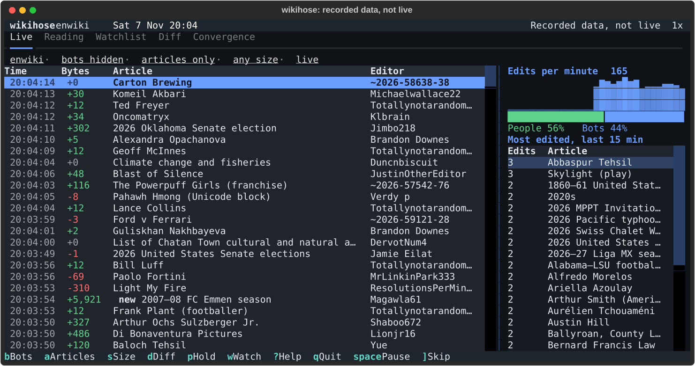

# wikihose

A terminal dashboard for watching Wikipedia live: what people are editing right now, what people are suddenly reading,
where the two overlap, and edits to the pages you choose to track.

**Status: 0.1.0 release candidate. All five tabs work; the first release is not published yet.**



*The Live tab playing the bundled demo recording (recorded data, not live).*

## What it shows

- **Live:** every edit as it happens, with the size of the change, edits per minute, the most edited articles of the
  last 15 minutes and the split between people and bots. Filter by wiki, bots, articles only and change size.
- **Reading:** the articles whose reading jumped most on the last full day, against their usual 30 days, with a
  sparkline and the article summary.
- **Watchlist:** pages you track. Press `w` on any article row, or `W` to type a title or paste a link. Edits to them
  are marked in the Live log and counted on the tab, including edits made while wikihose was closed.
- **Diff:** Enter on a watched page shows what changed since you last looked, removed text in red and added text in
  green.
- **Convergence:** articles hot in both: edited by people in the last 15 minutes and read at least twice their usual.
  An article that suddenly gets 10 edits has its own reading history fetched.

`?` lists every key. Every key in the footer is also a button, and rows and tabs take clicks. It fits an 80x24
terminal.

## Install

After the first release, either of these. With [pipx](https://pipx.pypa.io) (Windows, macOS or Linux, Python 3.12 or
later):

```powershell
pipx install wikihose
wikihose
```

Or, on Windows, download `wikihose-<version>-windows-x86_64.exe` from the
[releases page](https://github.com/WPTK/wikihose/releases) and run it. No Python is needed. Each release lists
`SHA256SUMS`, and `gh attestation verify wikihose.exe --repo WPTK/wikihose` checks that the file was built here.

Until then, run it from a development checkout (see [CONTRIBUTING.md](CONTRIBUTING.md) for setup), in PowerShell:

```powershell
.venv\Scripts\python -m wikihose --demo
.venv\Scripts\python -m wikihose
```

## Run it

```powershell
wikihose --demo        # a six-minute recording of English Wikipedia, with a recorded day of reading numbers; no network
wikihose               # live, English Wikipedia
wikihose --wiki dewiki # another wiki
wikihose --version
wikihose --selftest    # checks the install without the network
```

`wikihose --help` lists the rest (`--replay`, `--record`). `q` quits.

wikihose is an unofficial project. It is not affiliated with, endorsed by, or sponsored by the Wikimedia Foundation.
Wikipedia is a trademark of the Wikimedia Foundation. It reads public Wikimedia feeds and APIs and keeps well inside
their rate limits.

See [docs/design.md](docs/design.md) for how it works and [CONTRIBUTING.md](CONTRIBUTING.md) to help.

## License

Code: [MIT](LICENSE). Recorded Wikimedia data in the test fixtures and the demo is CC BY-SA 4.0; see [NOTICE](NOTICE).
